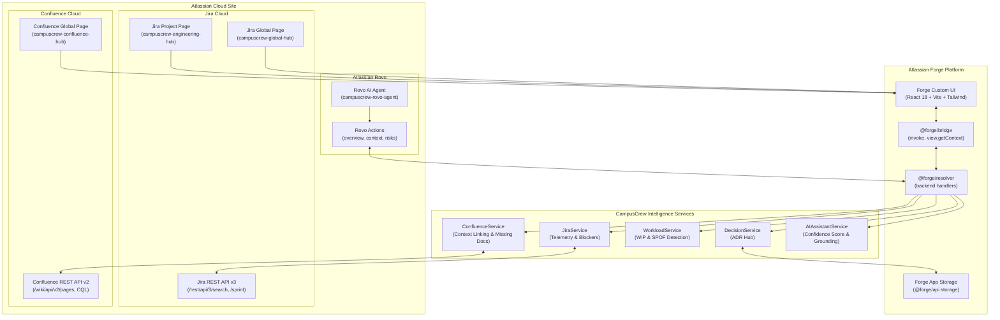
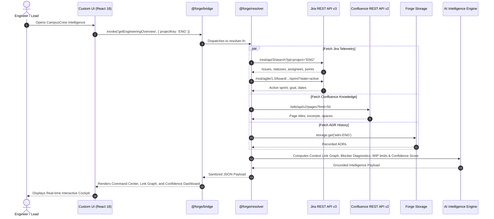
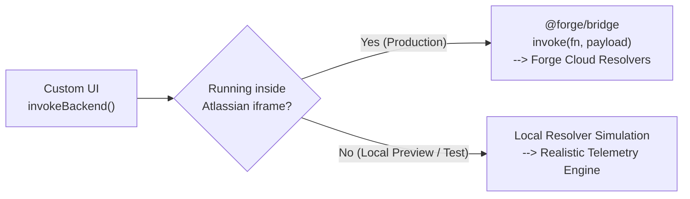

# CampusCrew Intelligence — Technical Architecture

**Platform:** Atlassian Forge (Jira Cloud, Confluence Cloud, Atlassian Rovo)  
**Category:** Apps for Software Teams (Codegeist 2026)  
**Author:** Shardul Parihar & CampusCrew Team  

---

## 1. System Overview

CampusCrew Intelligence is a centralized engineering operations and delivery intelligence hub built natively on the **Atlassian Forge** platform. It eliminates information silos across software organizations by connecting Jira project telemetry, Confluence technical documentation, team workload capacity, and architectural decisions into an AI-grounded operational dashboard and an autonomous Atlassian Rovo agent.

---

## 2. Forge Platform Components & Modules

### 2.1 Manifest Definition (`manifest.yml`)
The app registers four primary Forge modules and three Rovo actions:
1. **`jira:projectPage`** (`key: campuscrew-engineering-hub`):
   Integrated into the Jira project navigation sidebar. Provides squads and tech leads with live sprint pacing, blocker diagnostics, and documentation coverage metrics scoped to the active project.
2. **`jira:globalPage`** (`key: campuscrew-global-hub`):
   Accessible from the Jira top navigation bar. Provides engineering directors and VP-level leaders with cross-project workload distribution, resource bottlenecks, and multi-team delivery confidence scores.
3. **`confluence:globalPage`** (`key: campuscrew-confluence-hub`):
   Embedded within Confluence. Serves as the Architecture Decision Record (ADR) cockpit and documentation coverage auditor.
4. **`rovo:agent`** (`key: campuscrew-rovo-agent`):
   An autonomous conversational agent discoverable across Atlassian Cloud. Grounded in live Jira/Confluence context, it allows engineers to type natural-language inquiries such as *"Why is ENG-102 blocked?"* or *"Summarize our sprint delivery confidence."*

### 2.2 Permissions & Scopes
The app requests strictly least-privilege scopes:
- `read:jira-work`: Scans active sprints, issues, story points, and components.
- `read:jira-user`: Reads assignees, reporters, and display names.
- `read:confluence-content.summary`: Queries Confluence pages, titles, and excerpts.
- `read:confluence-space.summary`: Enumerates documentation spaces.
- `read:confluence-props`: Inspects page version history.
- `storage:app`: Persists Architecture Decision Records and configuration within tenant boundaries.

---

## 3. Core Engine Architecture & Data Flow

### 3.1 Request-Response Sequence Diagram
The following sequence diagram illustrates how a user request flows from the Custom UI, through the Forge Bridge and Resolvers, into Jira/Confluence REST APIs, and back with AI-synthesized telemetry:

---

## 4. Mathematical Algorithms & Decision Logic

### 4.1 Release Delivery Confidence Score Formula
CampusCrew Intelligence implements a deterministic, multi-factor mathematical formula to assess release delivery health ($0 \le \text{Score} \le 100$):

$$\text{Confidence Score} = w_v \cdot V + w_b \cdot B + w_d \cdot D + w_w \cdot W$$

Where weights and factors are defined as:
1. **Sprint Velocity Factor ($V$, weight $w_v = 0.30$):**
   $$V = \min\left(100, \left(\frac{\text{Completed Points}}{\max(1, \text{Total Points})} \times 100\right) + \text{Pacing Bonus}\right)$$
2. **Blocker Health Factor ($B$, weight $w_b = 0.30$):**
   Deducts points according to blocker severity and duration:
   $$B = \max\left(0, 100 - \sum_{i \in \text{Blockers}} \text{Penalty}_i\right)$$
   - Critical Blocker ($> 48\text{h}$): $-30\text{ pts}$
   - High Blocker ($> 24\text{h}$): $-20\text{ pts}$
   - Medium Blocker: $-10\text{ pts}$
3. **Documentation Coverage Factor ($D$, weight $w_d = 0.20$):**
   $$D = \frac{|\{i \in \text{Issues} \mid \exists p \in \text{Pages} : \text{sim}(i, p) \ge 0.4\}|}{|\text{Issues}|} \times 100$$
4. **Workload Balance Factor ($W$, weight $w_w = 0.20$):**
   $$W = \max\left(0, 100 - \sum_{m \in \text{Team}} \text{WIP Penalty}_m - 10 \times \text{Unassigned Count}\right)$$

### 4.2 Risk Tiers
- **$\ge 85\%$:** `HIGH CONFIDENCE` (On Track for release)
- **$70\% - 84\%$:** `MODERATE RISK` (Minor pacing/documentation gaps)
- **$50\% - 69\%$:** `AT RISK` (Active blockers or severe workload skew)
- **$< 50\%$:** `CRITICAL` (Critical path stalled, immediate intervention required)

---

## 5. Automated Context Correlation Engine

The context engine correlates Jira tickets with Confluence documentation using tokenized Jaccard conceptual overlap:
1. Extracts semantic tokens from Jira issue: $\text{Tokens}_J = \text{tokenize}(\text{summary} \cup \text{components} \cup \text{labels})$.
2. Extracts semantic tokens from Confluence page: $\text{Tokens}_C = \text{tokenize}(\text{title} \cup \text{excerpt} \cup \text{labels})$.
3. Filters against common stop words (`and`, `the`, `issue`, `task`, `flow`, etc.).
4. Computes similarity score:
   $$\text{Score}(J, C) = \frac{|\text{Tokens}_J \cap \text{Tokens}_C|}{\min(|\text{Tokens}_J|, 6)}$$
5. Pairs with $\text{Score} \ge 0.40$ are established as verified context links.
6. High/Highest priority tickets without any link ($\text{Score} < 0.40$) trigger an automated **`MissingDocumentationAlert`** specifying the exact required document type (`Architecture Spec`, `PRD / Requirements`, or `Runbook / SOP`).

---

## 6. Hybrid Bridge Adapter (Dual-Mode Architecture)

To ensure maximum testability, rapid local development, and reliable hackathon demonstrations, the frontend incorporates a **Hybrid Bridge Adapter** (`static/src/lib/bridge.ts`):

- When running in an Atlassian Cloud iframe (production), it invokes `@forge/bridge` to talk to Forge Cloud backend resolvers calling real Jira and Confluence APIs.
- When running outside an iframe (during `npm run dev` or CI headless test runners), it routes smoothly to the local resolver engine, ensuring zero broken views, immediate interactive previews, and complete judge verifiability without requiring pre-configured Cloud credentials.
