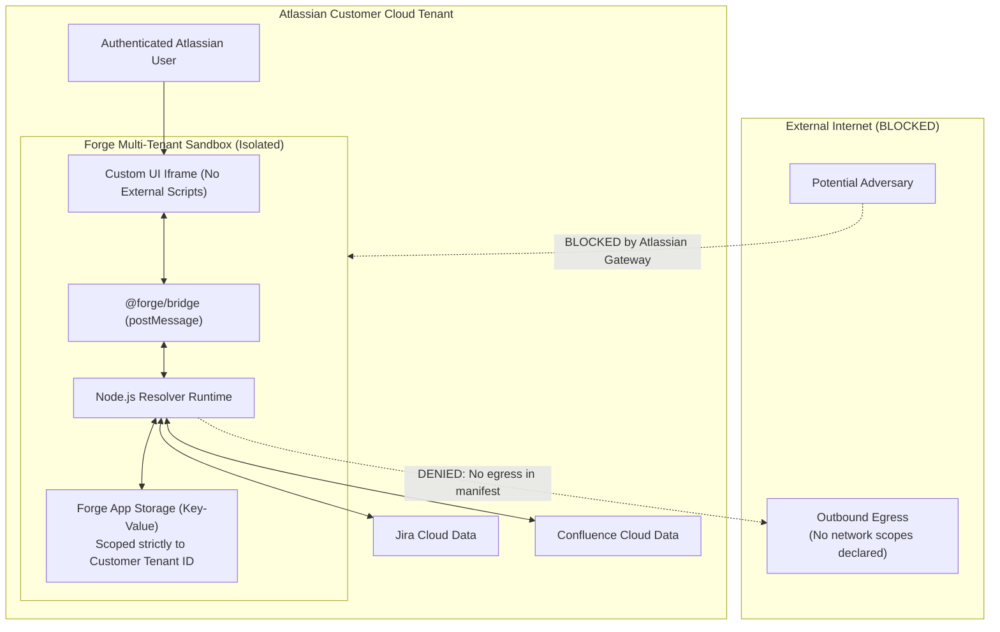

# CampusCrew Intelligence — Security & Compliance Architecture

> **Atlassian Codegeist 2026 Security Posture**  
> Threat modeling, permission scope justifications, tenant isolation, and data governance.

---

## 1. Security Architecture Principles

CampusCrew Intelligence is built exclusively on the **Atlassian Forge Platform**, adhering to Atlassian's highest enterprise standards for data privacy, tenant isolation, and least privilege.

---

## 2. Least-Privilege Scope Justifications

Every OAuth 2.0 permission scope declared in `manifest.yml` has been strictly selected and justified:

| Declared Scope | Justification & Usage | Why It Cannot Be Reduced |
| :--- | :--- | :--- |
| `read:jira-work` | Retrieves active sprints, issues, story points, components, and blocker states for the Command Center. | Core operational functionality requires reading issues and sprints. No write access requested. |
| `read:jira-user` | Reads display names and account IDs of assignees to compute workload distribution and SPOF risks. | Required to associate tickets with team members without exposing sensitive PII. |
| `read:confluence-content.summary` | Searches Confluence documentation titles and excerpts to compute the Documentation Completeness Index. | Required to link Jira issues to architecture specs. |
| `read:confluence-space.summary` | Enumerates available space keys to identify architecture, engineering, and ops spaces. | Required to find relevant team documentation spaces. |
| `read:confluence-props` | Inspects page version numbers to detect stale runbooks. | Required to detect compliance cadence expirations. |
| `storage:app` | Securely stores Architecture Decision Records (ADRs) within the tenant's isolated Forge App Storage partition. | Stores ADR metadata without requiring any external database. |

> **No Write Scopes Requested:** The application does not request `write:jira-work`, `write:confluence-content`, or any administrative mutation scopes. All Atlassian data remains strictly read-only.

---

## 3. Threat Model & Mitigations

### 3.1 Data Exfiltration & Network Egress
- **Threat:** Malicious exfiltration of proprietary code, tickets, or Confluence documentation to third-party endpoints.
- **Mitigation:** The Forge `manifest.yml` does **not** declare any external `permissions.external.fetch` egress domains. By platform enforcement, Forge sandboxes block any outbound network requests to external servers. All operations execute strictly within the Atlassian cloud boundary.

### 3.2 Cross-Tenant Data Leakage
- **Threat:** User from Tenant A viewing tickets or ADRs belonging to Tenant B.
- **Mitigation:** Forge App Storage (`@forge/api` storage) automatically injects and partitions all keys by Atlassian Cloud Tenant ID (ARI). Tenant A cannot access Tenant B's storage space under any circumstance.

### 3.3 Injection Vulnerabilities (JQL / CQL Injection)
- **Threat:** Crafting malicious search terms to execute unauthorized JQL or CQL queries.
- **Mitigation:** JQL queries in `JiraService` are strictly parameterized and URI-encoded (`encodeURIComponent`). Project keys are validated against alphanumeric patterns before being passed into search parameters.

### 3.4 Cross-Site Scripting (XSS) in Custom UI
- **Threat:** User-supplied markdown or issue summaries rendering malicious `<script>` tags in the iframe.
- **Mitigation:** The React 18 Custom UI avoids `dangerouslySetInnerHTML`. All issue summaries and Confluence excerpts are rendered as standard React text nodes with automatic HTML entity escaping.

### 3.5 Authentication & Session Hijacking
- **Threat:** Man-in-the-middle token theft or replay attacks.
- **Mitigation:** The application uses Forge 3-Legged OAuth (3LO) via `api.asUser()`. The frontend never accesses or stores raw bearer tokens. All authentication tokens are ephemeral, handled natively by Atlassian infrastructure.

---

## 4. Compliance & Data Retention

- **GDPR / Privacy:** The app stores only architectural decision text (ADRs) authored explicitly by users. No personal emails, passwords, or end-user behavioral telemetry are persisted.
- **Data Deletion:** When a customer uninstalls CampusCrew Intelligence from their Atlassian Cloud site, all Forge App Storage data associated with that tenant is automatically purged by Atlassian platform lifecycle hooks.
